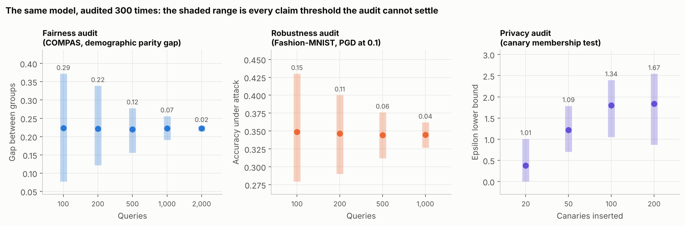
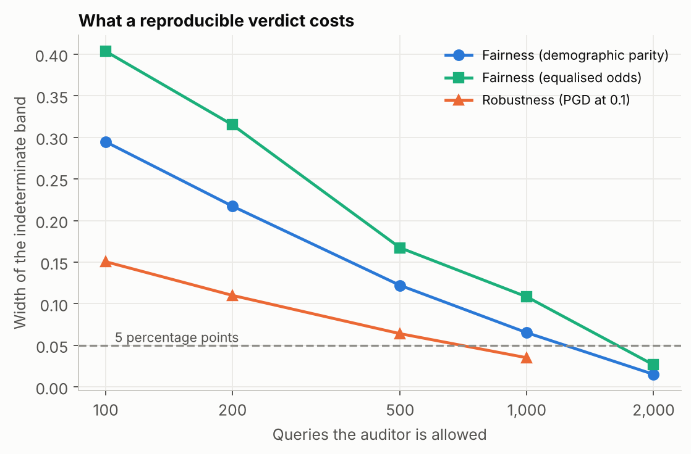
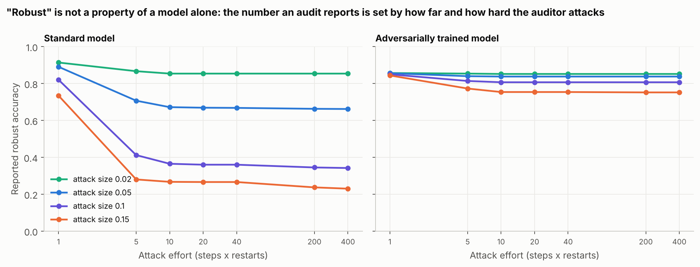
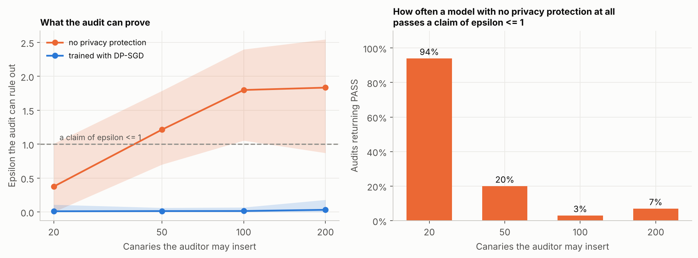
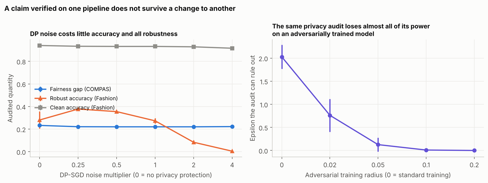

# Gatecrasher

**Audit-aware adversaries, robustness, and the verification of trustworthiness claims in ML.**

An audit is the gate which an ML trustworthiness claim has to pass before anyone trusts it with parameters like  *trained
with differential privacy at epsilon 1*, *robust to perturbations of size 0.1*, *fair across
groups*. AI Regulation increasingly requires such claims to be evidenced rather than an empirical test.

This repository examines what an audit can reliably tell us, without accusing anyone of malicious intentions.  The audit is repeated with different choices on the same model. The audit is conducted using different examples, random seed, how strong the attacks should be and added altercations. The different audit parameters reveals the audit internal flaws and uncertainity rather than the model changes.

**That spread is a lower bound on how little an audit establishes.** An audit that cannot
reproduce its own verdict against its own randomness cannot withstand an adversary either, so
every number here is optimistic about what auditing achieves, never pessimistic.



---

## Findings

Three audits, on two public datasets, against models trained by standard recipes:
group-fairness on COMPAS, L-infinity robustness on Fashion-MNIST, and a canary membership
test for differential privacy. Every number below is produced by `src/run_all.py` and written
to `results/headline.json`; nothing in this README is typed by hand.

### 1. The verdict is decided by the draw, not only by the model

Each audit was re-run 300 times on one fixed model. The **indeterminate band** is the
5th-95th percentile of the statistic: every claim threshold inside it gets a verdict the audit
itself would overturn at least 5% of the time. The band is defined before any threshold is
chosen, so it cannot be tuned to flatter or damn an audit.

| Audit | 100 queries | 500 queries | 1,000 queries | 2,000 queries |
|---|---|---|---|---|
| Fairness, demographic parity gap | **0.29** | 0.12 | 0.07 | 0.02 |
| Fairness, equalised odds gap | **0.40** | 0.17 | 0.11 | 0.03 |
| Robustness, accuracy under PGD at 0.1 | **0.15** | 0.06 | 0.04 | - |

At a 100-query audit, the COMPAS model's equalised-odds gap lands anywhere between 0.09 and
0.50. A regulator setting any threshold in that range is tossing a coin. The underlying model
never changes: its equalised-odds gap over the whole test set is 0.24 every time.

### 2. A reproducible verdict is expensive, and the metric choice changes the price



To get the band below 5 percentage points took **1,000** queries for the robustness audit and
**2,000** for either fairness metric, which is the entire COMPAS test set. Equalised odds
needs far more data than demographic parity for the same precision, because it splits the
sample four ways before comparing; an auditor who switches metric for good statistical reasons
silently changes how much evidence the same budget buys.

### 3. "Robust" is not a property of a model: it is a property of the audit



The same standard model, queried on the same 1,000 images, reports:

| Attack effort (steps x restarts) | size 0.02 | size 0.05 | size 0.1 | size 0.15 |
|---|---|---|---|---|
| 1 | 0.914 | 0.891 | **0.821** | 0.735 |
| 400 | 0.854 | 0.662 | **0.342** | 0.230 |

A one-step attack reports 0.82 robust accuracy at size 0.1; forty steps with ten restarts
report 0.34 on the same model and the same images. Both are reported in the literature as
"robust accuracy". Neither auditor has done anything improper, and a claim of "robust accuracy
at least 0.5" passes under one and fails under the other. The adversarially trained model, by
contrast, is insensitive to attack effort (0.85 to 0.81), which is what a claim that means
something looks like.

### 4. The privacy audit passes an unprotected model 94% of the time



The model under audit here was trained by plain SGD with **no privacy protection of any kind**,
so its true epsilon is unbounded. A canary membership test with a Clopper-Pearson bound was
asked whether it satisfies "epsilon at most 1":

| Canaries the auditor may insert | 20 | 50 | 100 | 200 |
|---|---|---|---|---|
| Mean epsilon the audit can rule out | 0.38 | 1.21 | 1.80 | 1.83 |
| **Audits returning PASS** | **94%** | 20% | 3% | 7% |

Nothing is being hidden from this audit: the canaries are out-of-distribution images with
random labels, the easiest possible thing to detect. The audit passes a model with no privacy
at all simply because, at a small canary budget, it has no statistical power. Even at 200
canaries it never rules out more than epsilon 2.95, against a true value of infinity. A
passing privacy audit is evidence about the audit, not about the model.

For contrast, the DP-SGD model's bound stays at 0.01-0.03 throughout, so the audit does
separate the two training recipes. What it cannot do is certify the number in the claim.

### 5. Claims interfere: verifying one does not leave the others standing



Raising the DP-SGD noise multiplier from 0 to 4 costs **2 points of clean accuracy** (0.94 to
0.92) and takes **robust accuracy from 0.28 to 0.004**. A robustness claim verified before a
privacy change, and re-checked afterwards only by the accuracy number everyone watches, is
false and looks fine.

In the other direction, adversarial training drives the privacy audit's bound from 2.03 down
to 0.00 as the training radius grows. The careful reading matters: this audit only ever
lower-bounds epsilon, so a smaller number means **the audit detected less**, not that the
model leaks less.

The distinction is not pedantic, because the true quantity is known to move the other way.
[Song, Shokri and Mittal (2019)](https://arxiv.org/abs/1905.10291) measured membership
inference against six robust training methods and found robust models leak *more* than
naturally trained ones: on Fashion-MNIST the membership-inference advantage rises from 14.2%
to 29.0%, and up to 4.5x on other datasets. Their attack targets in-distribution training
points, which robust training fits more tightly; the audit here asks whether an
out-of-distribution noise canary can be told from a held-out one, and adversarial training
flattens the loss surface over an entire epsilon-ball, which plausibly prevents the model
spiking on an isolated noise image. That explanation is not tested here and the two setups
are not directly comparable, but the direction of the gap is the point: **leakage rises while
the audit's reading falls.** An auditor who reports this number without the caveat reports
most reassurance exactly where there is most to find.

More generally, the audit's power depends on how the model was trained, which means its output
cannot be compared across pipelines, and a model can be made harder to audit by a change made
for an unrelated reason.

---

## Claim cards

`src/cards.py` writes a small machine-readable record (`results/claim_cards.json`) of a claim,
the audit, and what the audit can settle. Model cards and ML bills of materials already record
a claim and a verdict; the results above say a verdict is not interpretable on its own, so a
card here carries three more fields and a validator refuses it without them:

```json
{
  "id": "fairness-dp-500-loose",
  "statement": "The demographic parity gap between the two race groups is at most 0.25.",
  "threshold": 0.25, "direction": "at_most",
  "audit": {"method": "demographic parity difference on held-out individuals",
            "queries": 500, "replicates": 300},
  "measured": 0.2197,
  "indeterminate_band": [0.1557, 0.2777],
  "reproducibility": 0.76,
  "status": "INDETERMINATE"
}
```

`INDETERMINATE` is the field that does the work: it separates *the audit found the claim false*
from *this audit cannot tell*, which a bare PASS/FAIL silently merges. Run against a card that
reports only a verdict, the validator says what is missing:

```
privacy-eps-1: missing 'indeterminate_band' (verdict is not interpretable)
privacy-eps-1: missing 'reproducibility' (verdict is not interpretable)
privacy-eps-1: audit was run once, so it reports no band
```

## Design

| | |
|---|---|
| **Datasets** | [Fashion-MNIST](https://github.com/zalandoresearch/fashion-mnist) (t-shirt/top vs dress; 6,000 train, 2,000 test) and [COMPAS](https://github.com/propublica/compas-analysis) with ProPublica's own filtering (3,166 train, 2,112 test). Downloaded by the code, not redistributed here. |
| **Models** | Logistic regression and a one-hidden-layer network, written out in NumPy (`src/models.py`). The audits need per-example gradients, input gradients and an exact record of the noise added, and a reader checking an audit should see all three in one short file. Per-example clipping is exact: the Frobenius norm of an outer product factorises, so the norms come out without ever forming the per-example gradients. |
| **Privacy audit** | Canaries inserted into training, then told from held-out canaries by loss. Clopper-Pearson upper bounds on both error rates give a confidence-corrected lower bound on epsilon, the standard recipe, conservative by construction at small canary counts. |
| **Robustness audit** | L-infinity PGD with random start, swept over attack size and over steps x restarts. More restarts can only lower the reported number, which the tests check. |
| **Fairness audit** | Demographic parity and equalised-odds gaps on held-out individuals. Race is not a model input: the question is whether a model that never sees the attribute still scores the groups differently. |
| **Replication** | 300 audit replicates per setting (100 for privacy, where each replicate retrains a model). COMPAS at 2,000 queries draws almost the whole test set, so its small band there is partly arithmetic, not evidence of a reliable audit. |

## Run it

```bash
pip install -r requirements.txt
python src/run_all.py            # about 35 minutes on two cores, no GPU
python tests/test_gatecrasher.py # 15 checks on the bound, the attack, DP-SGD and the cards
```

Individual stages: `src/stability.py`, `src/interference.py`, `src/summary.py`,
`src/cards.py`, `src/figures.py`.

## Limitations

- **Small models and two datasets.** The mechanism, audit variance and audit power, does not
  depend on scale, but the specific numbers do. Nothing here establishes what the bands look
  like for a large model, and the query counts in finding 2 are not transferable.
- **One audit design per property.** There are stronger audits for all three properties, among
  them one-run privacy auditing and certified rather than empirical robustness. The claim is
  not that auditing cannot work; it is that the audits in common use report verdicts without
  the evidence needed to read them.
- **The DP-SGD here uses shuffled fixed-size batches**, not Poisson sampling, so the
  (clip, noise, epochs) triple cannot be converted into a formal epsilon. The repository never
  claims an epsilon for a trained model; it compares protected training against no protection.
- **No adversary is modelled.** Everything measured here is what an audit does to itself. An
  audit that is unreliable against its own randomness is at least that unreliable against a
  party with an interest in the outcome, but how much worse is not measured, and nothing in
  this repository should be read as a claim about how any real provider behaves.
- **Interference is measured on one pair of pipelines** at a time, and the privacy-to-
  robustness result is non-monotone at low noise (0.28 to 0.38 at noise 0.25 before falling),
  which is not explained here.

## Related work, and what is not new here

Each finding above is already established inside its own subfield, and in every case the
specialist literature does it better. Stating that plainly is the only way the rest of the
repository can be read for what it is.

| Finding | Where it is already known | How that work is stronger |
|---|---|---|
| 1-2. A fairness verdict moves under resampling, and a stable one is expensive | [Cherian and Candes, *Statistical Inference for Fairness Auditing*](https://arxiv.org/abs/2305.03712), 2023; [*Can I Trust My Fairness Metric?*](https://proceedings.neurips.cc/paper/2020/hash/d83de59e10227072a9c034ce10029c39-Abstract.html), NeurIPS 2020 | Simultaneous confidence bounds over every subgroup at once, by a rescaled bootstrap with family-wise error control, on COMPAS and Folktables. The percentile band used here is a cruder instrument on the same problem. |
| 3. Reported robust accuracy is set by attack effort | [Carlini et al., *On Evaluating Adversarial Robustness*](https://arxiv.org/abs/1902.06705), 2019; [AutoAttack and RobustBench](https://arxiv.org/abs/2010.09670), 2020 | This is the founding lesson of the field, and a standardised parameter-free attack plus a public leaderboard already exist to settle it. Nothing in finding 3 would surprise anyone who works on adversarial examples. |
| 4. A canary privacy audit has no power at a small canary budget | [Steinke, Nasr and Jagielski, *Privacy Auditing with One (1) Training Run*](https://arxiv.org/abs/2305.08846), NeurIPS 2023; [Nasr et al., *Tight Auditing of Differentially Private Machine Learning*](https://arxiv.org/abs/2302.07956), USENIX Security 2023 | The one-run auditing line exists precisely because multi-run canary auditing is underpowered, and it obtains far tighter bounds at a fraction of the cost. The audit here is deliberately the older, weaker recipe, on the grounds that it is the one in common use; it is not the state of the art and no result here should be read as a limit on what privacy auditing can do. |
| 5. Privacy noise costs robustness | [Bagdasaryan, Poursaeed and Shmatikov, *Differential Privacy Has Disparate Impact on Model Accuracy*](https://arxiv.org/abs/1905.12101), NeurIPS 2019; and the DP-SGD fairness and robustness analyses that followed it | Those results come with theory and hold at scale. The measurement here is empirical confirmation on a one-hidden-layer network. |
| Claim cards | [Staufer, Reuel, Yang and Casper, *Audit Cards: Contextualizing AI Evaluations*](https://arxiv.org/abs/2504.13839), 2025 | Audit Cards is the closest prior art and more thorough on everything to do with provenance, access and process integrity. It has no field for the statistical reliability of the audit's own verdict, which is the one place the cards here add something. |

What is left, once all of that is subtracted:

- **One threshold-free measurement applied identically to all three properties.** Privacy,
  robustness and fairness auditing have separate literatures with incompatible notions of
  reliability, and no common scale on which an auditor can ask which of three verdicts is the
  flimsiest. The indeterminate band is that scale. It is a modest contribution, but it is the
  reason the five findings sit in one repository rather than three.
- **An `INDETERMINATE` status, and a validator that refuses a card without a band.** A format
  proposal rather than a result, aimed at a specific gap in Audit Cards.
- **Audit power is a function of the training pipeline**, so the same audit's number is not
  comparable across pipelines, and can be reduced by a change made for an unrelated reason
  (finding 5, second half). Adjacent to Song et al. above, but not the same claim, and it runs
  in the opposite direction to the leakage itself.

The obvious way to make this stronger is to replace each audit with the best current method
and re-measure the bands, since *the state-of-the-art audit still cannot settle a band this
wide* is a claim worth making, and *the obsolete audit is unreliable* is not.

## Credits

Fashion-MNIST: H. Xiao, K. Rasul, R. Vollgraf, 2017. COMPAS: J. Angwin, J. Larson, S. Mattu,
L. Kirchner, ProPublica, 2016. DP-SGD follows Abadi et al., 2016; the empirical epsilon bound
follows the canary-auditing line of Jagielski et al., 2020 and Nasr et al., 2021; PGD follows
Madry et al., 2018.

*Author: Zubair, PhD student, University of Malakand.*
